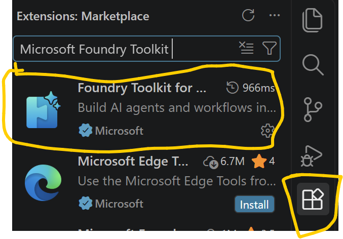
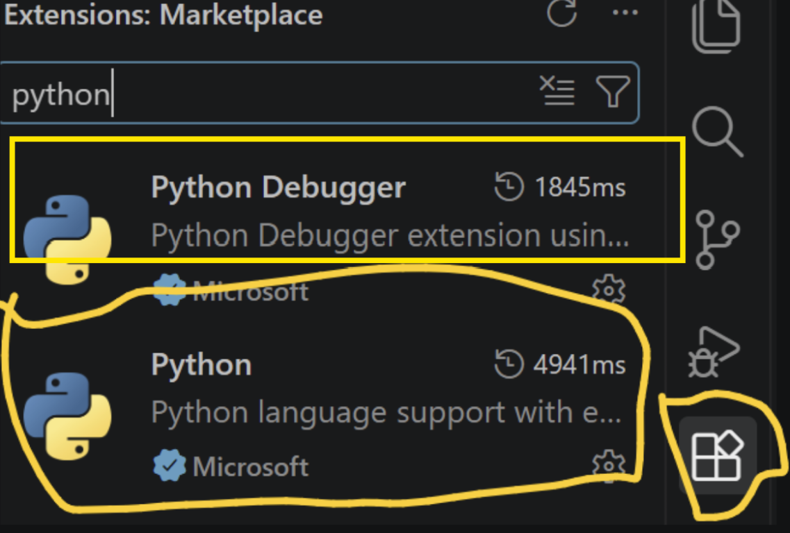
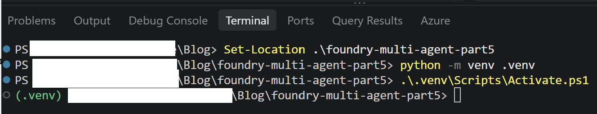
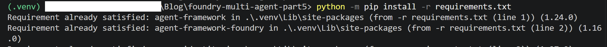
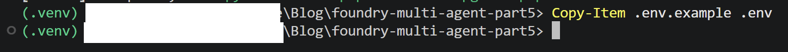
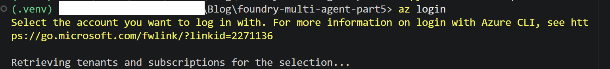
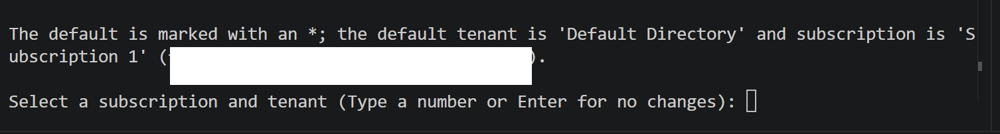
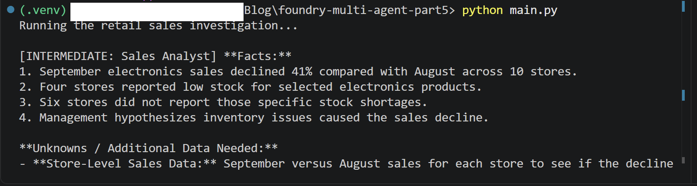
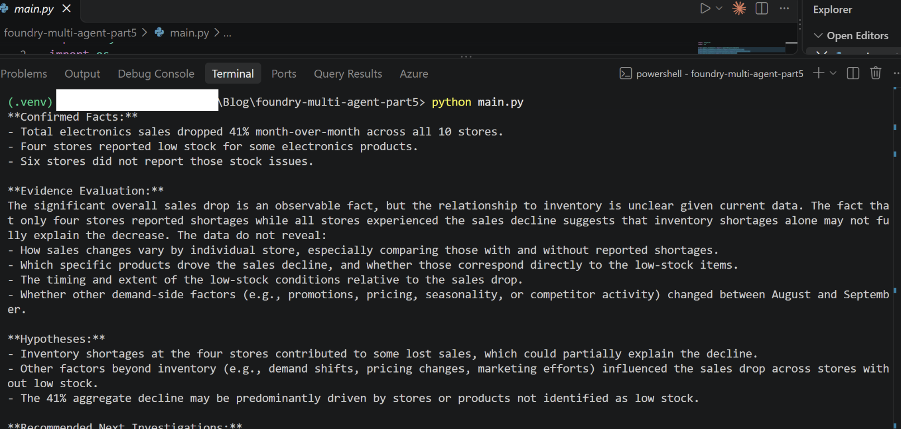

# Microsoft Foundry for Beginners - Part 5

This sample runs three specialist agents in a sequential workflow:

1. Sales Analyst reviews the reported sales decline.
2. Inventory Analyst tests whether the reported stock shortages support the cause.
3. Business Advisor combines the findings and recommends next investigations.

The example uses only the scenario facts in `main.py`; it does not connect to sales
or inventory data. Treat its recommendations as advisory, not as proof of cause.

## Prerequisites

- Python 3.10 or later
- Azure CLI, signed in with `az login`
- A Microsoft Foundry project and a deployed chat model
- Permission to invoke that model

## Set up Visual Studio Code

1. In VS Code, choose **File > Open Folder** and open the
   `foundry-multi-agent-part5` folder (not its parent `Blog` folder).
2. Open **Extensions** with `Ctrl+Shift+X` and install:
   - [Python](https://marketplace.visualstudio.com/items?itemName=ms-python.python) by Microsoft.
   - [Python Debugger](https://marketplace.visualstudio.com/items?itemName=ms-python.debugpy) by Microsoft.
   - [Microsoft Foundry Toolkit](https://marketplace.visualstudio.com/items?itemName=ms-windows-ai-studio.windows-ai-studio)
     to browse Foundry models, use the model playground, and work with Foundry resources in VS Code.
3. Open the integrated terminal with **Terminal > New Terminal**. Run the setup
   commands below there.

In the Extensions view, search for and install the Microsoft Foundry Toolkit:



Install the Microsoft Python and Python Debugger extensions as well:



All supplied screenshots are stored in the project's `images` folder and embedded
in this README. To view them in VS Code, open this file and press `Ctrl+Shift+V`
to show the Markdown preview.

The Foundry Toolkit is optional for running this Python sample. Use the integrated
terminal to run `main.py`; the Toolkit does not run this script for you. This code
uses `AzureCliCredential`, so sign in with `az login` even if you have signed in
to Foundry Toolkit.

## Setup on Windows (PowerShell)

Run these commands from the `foundry-multi-agent-part5` folder. If your terminal
is currently in the parent `Blog` folder, move into the project folder first:

```powershell
Set-Location .\foundry-multi-agent-part5
```

Create and activate the virtual environment:

```powershell
python -m venv .venv
.\.venv\Scripts\Activate.ps1
```



With `(.venv)` shown in the terminal prompt, install the dependencies:

```powershell
python -m pip install -r requirements.txt
```



If `.env` does not already exist, copy the example settings file:

```powershell
Copy-Item .env.example .env
```



If you use **Command Prompt** (`cmd.exe`) instead of PowerShell, run the equivalent
commands below from the parent `Blog` folder. This creates the environment inside
the project folder:

```bat
cd /d C:\Users\meeta\Source\Blog\foundry-multi-agent-part5
python -m venv .venv
.venv\Scripts\activate.bat
python -m pip install -r requirements.txt
if not exist .env copy .env.example .env
```

In Command Prompt, use `.venv\Scripts\activate.bat` to activate the environment.
The remaining commands such as `az login`, `python main.py`, and `deactivate` work
in either shell. Edit `.env` in VS Code before running the app.

In VS Code, open the Command Palette with `Ctrl+Shift+P`, run **Python: Select
Interpreter**, and choose the interpreter under `.venv\Scripts\python.exe`.

Edit `.env` and replace both placeholders. Use the project endpoint from Foundry,
not the Foundry portal URL. It should use the `https://` scheme and look like:

```text
FOUNDRY_PROJECT_ENDPOINT=https://<resource>.services.ai.azure.com/api/projects/<project>
FOUNDRY_MODEL=<model-deployment-name>
```

Keep `.env` private and do not commit it.

The variable names must match the ones used by `main.py`. The endpoint must be
the Foundry project endpoint, and the model value must be the deployed model's
deployment name. Replace every placeholder before running the sample.

Sign in to Azure CLI:

```powershell
az login
```



Select the tenant and subscription that contain your Foundry project. If Azure CLI
prompts you to choose a subscription, select **Subscription 1**:



Confirm the active subscription before running the sample:

```powershell
az account show --query "{name:name,id:id}" --output table
```

If the active subscription is not the one containing your project, set it by the
subscription ID shown in the Azure portal:

```powershell
az account set --subscription "<subscription-id-from-portal>"
az account show --query "{name:name,id:id}" --output table
```

Then run the workflow:

```powershell
python main.py
```

The terminal streams the Sales Analyst and Inventory Analyst outputs as
intermediate results, followed by the Business Advisor's final recommendation.

Example terminal output:



When you are finished working, deactivate the virtual environment:

```powershell
deactivate
```

## Manual test cases

The sample currently runs the scenario defined by `SCENARIO` in `main.py`. To try
the other cases, replace that scenario text and run `python main.py` again.

Example output from testing the workflow:



| Test | Scenario to provide | Expected behavior |
|---|---|---|
| Basic workflow | September electronics sales fell 41% across 10 stores. | All three agents respond in order, and the advisor gives a final recommendation. |
| Challenge the inventory hypothesis | Four stores reported low stock for selected products; six did not report those shortages. | Agents do not treat 4 of 10 stores as 40% of lost revenue or conclude inventory caused the overall decline. |
| Missing evidence | No store-level revenue, transaction, product, or inventory details are available. | Agents acknowledge the limits of the evidence and identify the data needed; they do not invent figures. |

## Troubleshooting

If the run fails with a connection error, check that `FOUNDRY_PROJECT_ENDPOINT`
uses `https://` (not a misspelled scheme such as `hhttps://`) and is the Foundry
project endpoint. Confirm that your machine can reach the project; projects using
private networking must be accessed from an allowed network. Do not paste or share
the contents of `.env` when asking for help.
